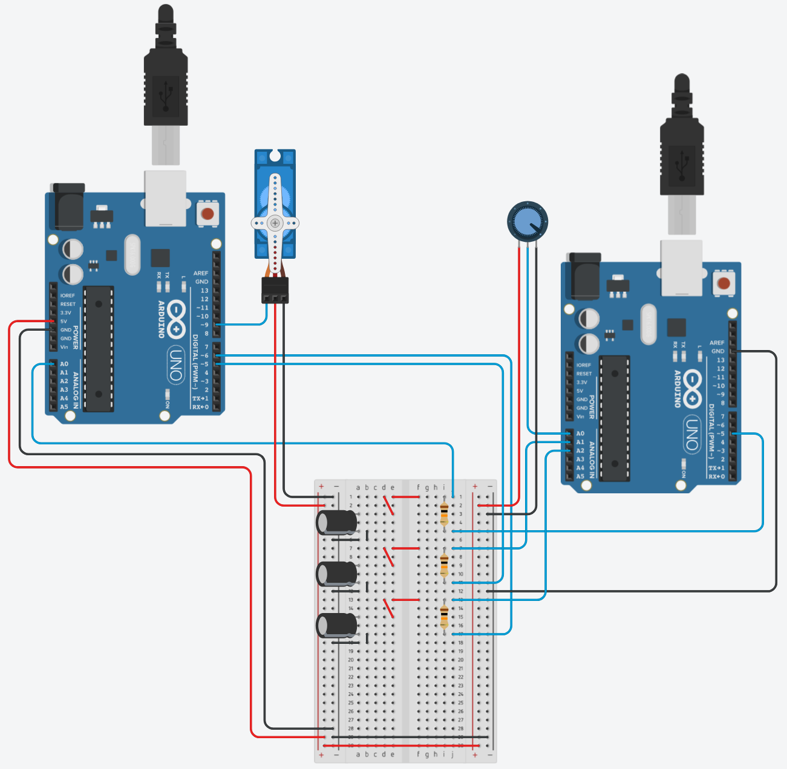
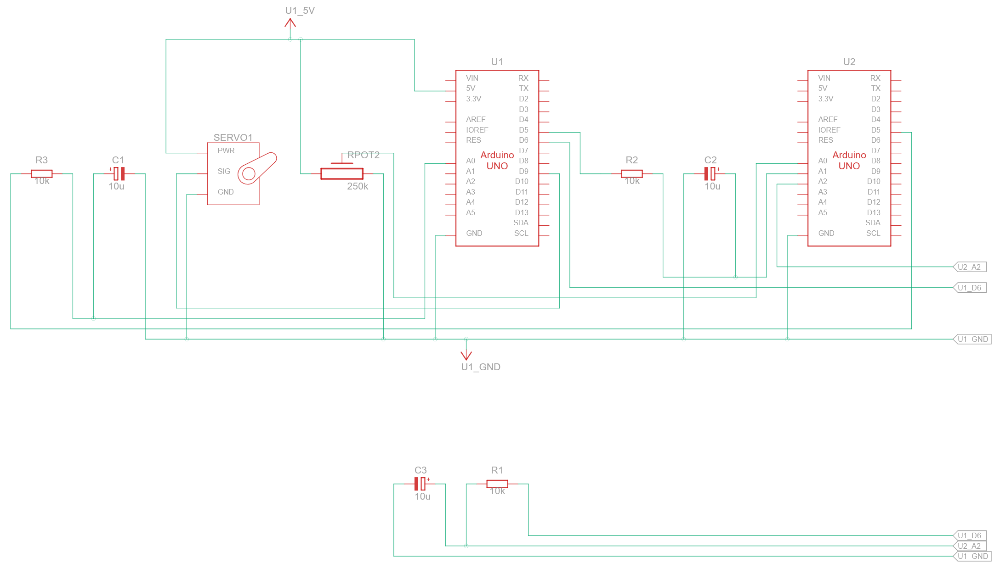

# Heavy Machinery Control Simulation (v3 — Dual-Arduino HIL with Velocity Feedback)

A true **Hardware-in-the-Loop (HIL)** simulation built across **two Arduino Uno** boards that models the rotational physics and closed-loop PID control of heavy machinery (such as a turret, radar dish, or aircraft yaw axis).

- **Left Arduino (Heavy Machinery / Plant):** Receives raw motor power commands over filtered PWM, integrates rotational inertia, drag, and hard stops at 50 Hz, drives a visual servo gauge, and transmits both heading angle and angular velocity feedback back to the controller.
- **Right Arduino (Controller / Pilot):** Reads the operator's target heading from a rotary potentiometer, receives real-time angle and velocity feedback from the plant, and computes PID actuator commands.

## What's New in v3
- **Dedicated Velocity Feedback Channel (`D6` → `A2`):** Added a third hardware RC low-pass filter stage (`10 kΩ` + `10 µF`) so the Plant transmits true angular velocity (`-187.5°/s` to `+187.5°/s`) directly to the Controller.
- **Direct Velocity Damping (Eliminated Derivative Stair-Stepping):** Replaced numerical differentiation (`(error - lastError) / dt`) on quantized 8-bit PWM angle readings with direct velocity feedback (`-Kd * measuredSpeed`), yielding clean, jitter-free braking.
- **180° Symmetrical Sweep & Tuned Gains:** Standardized operating range to `-90°` to `+90°` (`1:1` match with the micro servo) with updated PID gains (`Kp = 2.0`, `Ki = 0.01`, `Kd = 3.0`) and 4-channel Serial Plotter telemetry.

## Features
- **Decoupled HIL Architecture:** Allows testing and tuning controller firmware safely against a simulated physical plant before deploying to real hardware.
- **Physics-Based Plant Model:** Simulates rotational inertia, bearing/air drag, torque limits (`maxSpeed = maxMotorTorque / friction`), and mechanical hard stops (`-90°` to `+90°`).
- **50 Hz Fixed-Step Control & Physics Loops:** Both boards run synchronized `dt = 0.02s` loops for deterministic integration and control.
- **Real-Time Serial Plotter Telemetry:** Outputs `Target`, `Control`, `Angle`, and `Speed` values formatted for live graphing.

## Hardware & Wiring

### Components
- 2× Arduino Uno
- 1× Rotary Potentiometer (`250 kΩ`)
- 1× Micro Servo Motor (`180°`)
- 3× `10 kΩ` Resistors (RC low-pass filters)
- 3× `10 µF` Electrolytic Capacitors (RC low-pass filters)
- 1× Breadboard & Jumper Wires

### Pin Connections

#### Shared Power & Ground Rails

| Connection | From | To | Notes |
| :--- | :--- | :--- | :--- |
| **Common 5V Rail** | Left Arduino `5V` | Breadboard `+` Rail | Powers Servo and Potentiometer |
| **Common Ground** | Left Arduino `GND` | Right Arduino `GND` | Bridged via breadboard `-` rails; required reference for inter-board signals |

#### Left Arduino — Heavy Machinery / Plant (`U1`)

| Component / Signal | Pin / Node | Left Arduino Pin | Notes |
| :--- | :--- | :--- | :--- |
| **Control In** | From RC Filter 1 node | `A0` | Smoothed motor torque command (`-100%` to `+100%`) |
| **Angle Feedback Out** | To RC Filter 2 (`10 kΩ`) | `D5` | 980 Hz PWM current heading angle (`-90°` to `+90°`) |
| **Speed Feedback Out** | To RC Filter 3 (`10 kΩ`) | `D6` | 980 Hz PWM current angular velocity (`-187.5°/s` to `+187.5°/s`) |
| **Servo Motor** | `PWR` | `5V` | Breadboard `+` rail |
| **Servo Motor** | `SIG` | `D9` | Visual angle indicator (`0°` to `180°`) |
| **Servo Motor** | `GND` | `GND` | Breadboard `-` rail |

#### Right Arduino — Controller / Pilot (`U2`)

| Component / Signal | Pin / Node | Right Arduino Pin | Notes |
| :--- | :--- | :--- | :--- |
| **Potentiometer** | `Terminal 1` | `GND` | Left limit (`-90°`) via breadboard `-` rail |
| **Potentiometer** | `Wiper` | `A0` | Target heading input (`-90°` to `+90°`) |
| **Potentiometer** | `Terminal 2` | `5V` | Right limit (`+90°`) via breadboard `+` rail |
| **Control Out** | To RC Filter 1 (`10 kΩ`) | `D5` | 980 Hz PWM control signal (`-100%` to `+100%`) |
| **Angle Feedback In** | From RC Filter 2 node | `A1` | Smoothed heading angle from Plant (`-90°` to `+90°`) |
| **Speed Feedback In** | From RC Filter 3 node | `A2` | Smoothed angular velocity from Plant (`-187.5°/s` to `+187.5°/s`) |

#### RC Low-Pass Filters (3× Identical Stages)
Each inter-board PWM line passes through a `1.6 Hz` low-pass filter (`10 kΩ` series resistor + `10 µF` shunt capacitor to `GND`) to convert the 980 Hz square wave into a steady analog DC voltage before `analogRead()`:
1. **Filter 1 (Control):** Right Arduino `D5` → `10 kΩ` → (`10 µF` to `GND`) → Left Arduino `A0`
2. **Filter 2 (Angle):** Left Arduino `D5` → `10 kΩ` → (`10 µF` to `GND`) → Right Arduino `A1`
3. **Filter 3 (Speed):** Left Arduino `D6` → `10 kΩ` → (`10 µF` to `GND`) → Right Arduino `A2`

## Design
### Circuits


### Schematic


## Video
<video src="" controls="controls" style="max-width: 730px;"></video>

## How It Works

1. **Pilot Target Input (Right Arduino):** Reads the potentiometer on `A0` (`0–1023`) and maps it across the 180° range (`-90°` to `+90°`).
2. **Dual-Channel Feedback Sensing (Right Arduino):** Reads the filtered analog voltages on `A1` and `A2` sent by the Plant Arduino to determine `measuredAngle` (`-90°` to `+90°`) and `measuredSpeed` (`-187.5°/s` to `+187.5°/s`).
3. **PID Control Law (`computeController`):** Calculates heading error, integrates error with clamping (`[-100, 100]`), applies direct velocity damping (`-Kd * measuredSpeed`), and outputs a normalized actuator command (`-100%` to `+100%`) as a `0–255` PWM duty cycle on `D5`.
4. **Plant Physics Integration (`simulatePlant` on Left Arduino):** Reads the smoothed control voltage on `A0`, converts it into motor torque, subtracts rotational drag (`friction * speed`), and integrates angular acceleration over `dt = 0.02s` to update `speed` and `angle` within `[-90°, +90°]`.
5. **Actuation & Dual Return Telemetry (Left Arduino):** Updates the servo position on `D9` and outputs the new heading angle on `D5` and angular speed on `D6` back through the RC filters to the Right Arduino, while the Right Arduino prints 4-channel telemetry for the Serial Plotter:
   ```text
   45.00,62.50,28.40,14.20
   ```

## Tunable Parameters

### Controller (`Right Arduino`)
```cpp
// PID Gains (Tuned for high-inertia response with direct velocity feedback)
float Kp = 2.0;   // Proportional turning force
float Ki = 0.01;  // Integral steady-state correction (clamped to ±100)
float Kd = 3.0;   // Direct velocity braking/damping
```

### Heavy Machinery Plant (`Left Arduino`)
```cpp
// Heavy Machinery Physics
float maxMotorTorque = 150.0; // Max torque at 100% control signal
float inertia = 5.0;          // Mass resistance to turning (higher = heavier)
float friction = 0.8;         // Rotational bearing/air drag
float maxSpeed = maxMotorTorque / friction; // Terminal angular speed (187.5 deg/s)
```

## Future Improvements
- Upgrade the RC filters to **2-stage (second-order) low-pass filters** or switch to **digital UART/I2C/CAN communication** to eliminate residual PWM ripple and 8-bit quantization steps.
- Add simulated external disturbances (e.g., wind gusts or variable payload mass) on the Plant Arduino to stress-test controller disturbance rejection.
- Re-enable and tune the input deadband or add a conditional integral anti-windup zone to further minimize steady-state hunting around the target angle.

## Acknowledgements
Special thanks to [Tinkercad Circuits](https://tinkercad.com) for providing the circuit simulation tools used to design, test, and iterate on this project.
